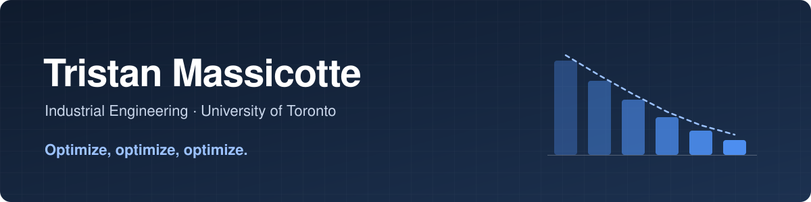
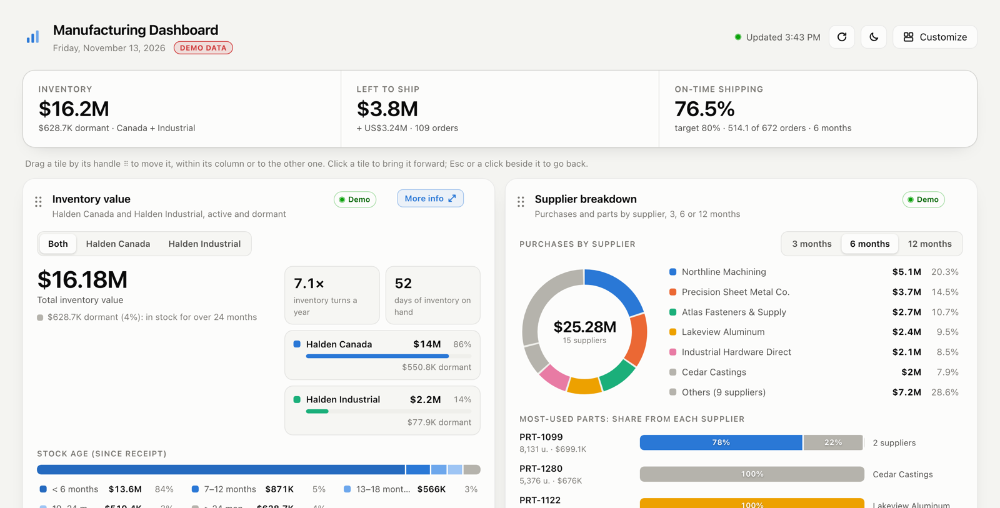

  

  
  
  
  

---

## About me in a nutshell

**Optimize, optimize, optimize.** Whether it's the way I cook my meals or the way a factory runs, I'm addicted to optimizing.

- **Industrial Engineering at the University of Toronto** (class of 2029), French and English.
- **Manufacturing Software Developer at Technimount System,** a manufacturer in Québec, after a summer there as Continuous Improvement Intern. The MRP system I built cut order processing **from 5 days to half a day**.

 

# &nbsp;🏭&nbsp; Built at Technimount System

I design the logic and rules; I build the apps with AI coding tools. The code belongs to Technimount, so three of these tools stay internal. Two have public demos rebuilt on fictional data.

### MRP system &nbsp;purchasing and requirements planning · internal

 

- **What it is.** The buyers' daily answer to *"what must I order today so it arrives in time?"* Open sales orders are netted against stock, exploded through the bills of materials and filtered by each part's lead time. A second track reorders assemblies that fall below their reorder point.
- **What changed.** Order processing went **from 5 days to half a day (−90%)**, from quote to purchase order. In fall 2026 I rebuilt it as a web app, and the report went **from about 8.5 minutes to under a second**.
- **Skills shown.** MRP logic (BOM explosion, lead-time netting, reorder points), turning a purchasing process into a tool buyers trust.

 

### [Sales dashboard](https://tristan-massicotte.github.io/sales-dashboard/) &nbsp;3 companies, 2 currencies &nbsp;

  

- **What it is.** Sales by salesperson for three companies billing in CAD and USD, with drill-down to every invoice, a map of sales by region, a KPI page (credit notes, unpaid invoices by age), and one-click Excel and PowerPoint exports for the leadership meeting.
- **What changed.** About 1,800 invoices, **matched to Zoho to the cent**. In daily use.
- **Skills shown.** Writing down the calculation rules (credit notes, taxes, CAD and USD kept apart) and checking them against the books.

  
   Sales dashboard demo, map page (fictional data).

 

### [Manufacturing dashboard](https://tristan-massicotte.github.io/manufacturing-dashboard/) &nbsp;for the production director and CEO &nbsp;

 

- **What it is.** One screen for the plant: inventory value and age at FIFO cost, open sales and purchase orders, purchases by supplier, stock cover for the best sellers, and on-time shipping against an 80% target.
- **The rules that mattered.** Parts used in assemblies are traced through FIFO lots back to the supplier they actually came from. On-time is judged per order line, so an order with 3 of 4 lines on time counts as 0.75.
- **Skills shown.** Inventory metrics (age, dormant stock, turns, days on hand), on-time delivery, supplier analysis.

  
   Manufacturing dashboard demo (fictional data).

 

### Quote tool &nbsp;supplier quotes for manufactured parts · internal

 

- **What it is.** One project is one request-for-quote cycle. The tool builds a **ZIP of every part's drawings automatically** and **emails it to each supplier** with the quote form, no manual packaging.
- **The part I'm proudest of.** When a supplier sends back their Excel quote, I reverse-engineer their pricing into a **price curve by quantity**, so we can price an assembly near-exactly for any order quantity, not just the 5 tiers they quoted, and compare it against our target cost.
- **Where it is.** Deployed and in use. It replaced an Excel workbook.
- **Skills shown.** Sourcing and cost modelling, automating the repetitive half of purchasing.

 

### Clear-to-build dashboard &nbsp;every open order, 4 companies · internal

  

- **What it is.** Each open customer order is sorted into *ready to ship*, *to assemble* (parts in stock, multi-level BOMs), *waiting on a PO* (with the PO), or *to order* (which part is missing, and how many). The oldest orders get stock and incoming POs first.
- **What changed.** **6 hours a week saved** (3 hours each for 2 people).
- **Skills shown.** Clear-to-build analysis, finding the bottleneck part, allocating scarce stock by priority.

 

# &nbsp;🛍️&nbsp; Soma

### [Soma](https://apps.shopify.com/soma) &nbsp;founder and developer · launched May 2026 &nbsp;

 

- **What it is.** A Shopify app that adds AI virtual try-on to a store's product pages. The merchant drops a "Try it now" button onto the product page from the theme editor, and shoppers see the clothes on themselves without leaving the site.
- **The piece I'm proudest of.** A Web Pixel that attributes purchases back to a try-on, which let me price the product as a share of attributed revenue rather than a subscription.
- **Where it is.** Used by La Boutique du Lac. I was interviewed on FM93 about it.

 

Technimount code stays with Technimount. The demos are separate rebuilds on fictional data, published with permission.
