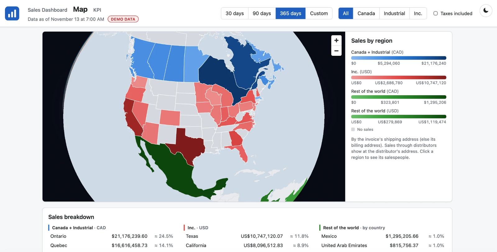

# Tristan Massicotte

**Optimize, optimize, optimize.** Whether it's the way I cook my meals or the way a factory runs, I'm addicted to optimizing.

Industrial Engineering at the University of Toronto (class of 2029). Manufacturing Software Developer at Technimount System, a manufacturer in Québec. French and English.

[LinkedIn](https://linkedin.com/in/tristan-massicotte) · [Internship highlights](https://tristan-massicotte.github.io/engineering-internship-highlights) · [Email](mailto:tristanmassicotte@me.com)

---

## Built at Technimount System

Tools for a manufacturer that runs on Zoho, built since May 2026. The code belongs to Technimount, so three of these are internal. Two have public demos rebuilt on fictional data.

| Tool | What it does | Result | |
|---|---|---|---|
| **MRP system**  summer 2026 | Turns open orders and stock into what to buy, from quote to purchase order | Order processing: 5 days → half a day (−90%) | Internal |
| **Sales dashboard** | Sales by salesperson for 3 companies in 2 currencies, a sales map, KPIs, Excel and PowerPoint export | About 1,800 invoices, matched to Zoho to the cent | **[Live demo](https://tristan-massicotte.github.io/sales-dashboard/)** |
| **Manufacturing dashboard**  summer 2026 | Inventory value and age, open orders, purchasing, suppliers, on-time shipping | | **[Live demo](https://tristan-massicotte.github.io/manufacturing-dashboard/)** |
| **Quote tool** | Prices a request for quote at 5 quantity tiers against a target cost | | Internal |
| **Clear-to-build dashboard** | Every open order across 4 companies: which can ship now, in priority order, and for the rest, the part that blocks it and its open PO | 6 h per week saved | Internal |

<table>
<tr>
<td width="50%"></td>
<td width="50%"></td>
</tr>
<tr>
<td align="center">Manufacturing dashboard demo (fictional data)</td>
<td align="center">Sales dashboard demo (fictional data)</td>
</tr>
</table>

## Soma

**Founder and developer** · launched May 2026 · [Shopify App Store](https://apps.shopify.com/soma) · [Website](https://somastudios.fashion)

A Shopify app that adds AI virtual try-on to a store's product pages, so shoppers can see the clothes on themselves without leaving the site.

- Used by La Boutique du Lac.
- Interviewed on FM93 about it.

## Toolkit

Excel modelling · MRP and inventory planning · Zoho · Python · TypeScript and React

Technimount code stays with Technimount. The demos are separate rebuilds on fictional data, published with permission.
